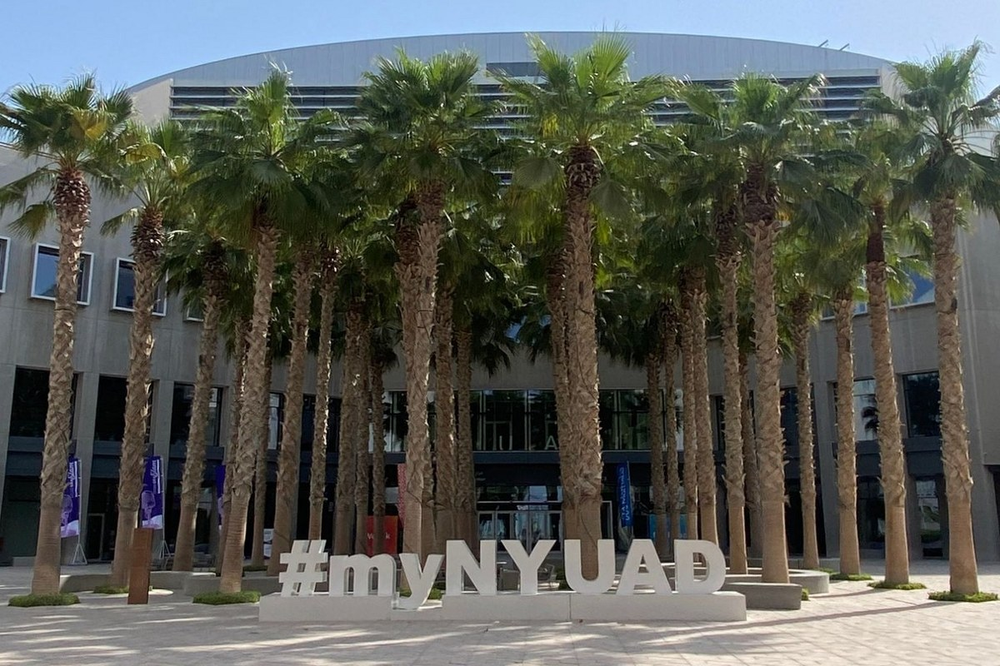

I am an Assistant Professor at NYU Abu Dhabi and a [research affiliate](https://cepr.org/about/people/alais-martin-baillon) at CEPR. My research interests are Macroeconomics, Monetary Economics, and Firm Dynamics. 

<!-- ====== -->

My CV is available [here](https://alais-martinbaillon.github.io/files/MartinBaillon_CV.pdf).

**📢 Job opening (2026–27):** The Economics Division at NYU Abu Dhabi is hiring an **Assistant Professor of Economics** (open field). [**Apply here**](https://apply.interfolio.com/196196). Feel free to [contact me](mailto:alais.martin.baillon@nyu.edu) if you have any questions (I'm sure you have many).

